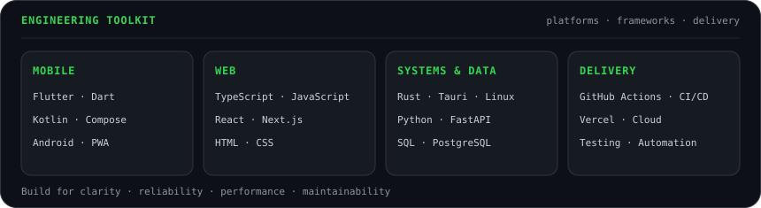

# Anshdeep Singh

**Software Developer · Data Science Student · Video Editor & Digital Creator**

Building useful digital products at the intersection of engineering, design and automation.

<a href="https://anshdeepofficial1.vercel.app/coding"><strong>Coding Portfolio</strong></a> &nbsp;·&nbsp;
<a href="https://anshdeepofficial1.vercel.app/editing"><strong>Editing Portfolio</strong></a> &nbsp;·&nbsp;
<a href="https://anshdeepofficial1.vercel.app/work"><strong>All Projects</strong></a> &nbsp;·&nbsp;
<a href="https://anshdeepofficial1.vercel.app/contact"><strong>Contact</strong></a>

---

## About me

I'm pursuing **BCA (Hons. with Research) in Data Science at Chandigarh University**. I develop Android applications, responsive websites, desktop software and automation tools, alongside video editing, motion graphics and visual design.

My approach is product-focused: understand the problem, build a reliable solution, refine the experience, and keep improving through testing and feedback. I care about thoughtful interfaces, maintainable code, privacy and practical automation.

## Featured projects

A curated selection of my public projects, spanning mobile applications, web products, machine learning and systems engineering. Select a project logo or name to open its GitHub repository; dedicated website and release links are provided separately.

<table>
  <tr>
    <td width="33%" align="center" valign="top">
       
      <a href="https://github.com/anshdeepofficial1/AniDash"><strong>AniDash</strong></a> 
      Flutter · Dart  
      Anime discovery, personal library and watch-progress management.  
       
      <a href="https://github.com/anshdeepofficial1/AniDash">Repository</a> · <a href="https://anidashweb.vercel.app/">Website</a> · <a href="https://github.com/anshdeepofficial1/AniDash/releases">Releases</a>
    </td>
    <td width="33%" align="center" valign="top">
       
      <a href="https://github.com/anshdeepofficial1/VYBE"><strong>VYBE</strong></a> 
      Kotlin · Jetpack Compose  
      Android music player for local listening, discovery and lyrics.  
       
      <a href="https://github.com/anshdeepofficial1/VYBE">Repository</a> · <a href="https://vybetune.vercel.app/">Website</a> · <a href="https://github.com/anshdeepofficial1/VYBE/releases">Releases</a>
    </td>
    <td width="33%" align="center" valign="top">
       
      <a href="https://github.com/anshdeepofficial1/Copy-Cloud"><strong>CopyCloud</strong></a> 
      Web · JavaScript  
      Instant cross-device text and file transfer with short retrieval codes.  
       
      <a href="https://github.com/anshdeepofficial1/Copy-Cloud">Repository</a> · <a href="https://copycloud.me/">Open website</a>
    </td>
  </tr>
  <tr>
    <td width="33%" align="center" valign="top">
       
      <a href="https://github.com/anshdeepofficial1/ZYLO"><strong>ZYLO</strong></a> 
      Kotlin · Compose  
      Android media hub with a browsable catalog, personal library and playback interface.  
       
      <a href="https://github.com/anshdeepofficial1/ZYLO">Repository</a> · <a href="https://zylod.vercel.app/home">Web app</a> · <a href="https://github.com/anshdeepofficial1/ZYLO/releases">Releases</a>
    </td>
    <td width="33%" align="center" valign="top">
      
      <a href="https://github.com/anshdeepofficial1/NOVA"><strong>NOVA OS</strong></a> 
      Rust · Tauri · Debian  
      Experimental Linux desktop OS and native workspace with a Rust host service and compatibility planning.  
       
      <a href="https://github.com/anshdeepofficial1/NOVA">Repository</a> · <a href="https://github.com/anshdeepofficial1/NOVA#product-architecture">Architecture & roadmap</a>
    </td>
    <td width="33%" align="center" valign="top">
      
      <a href="https://github.com/anshdeepofficial1/SocialBoost"><strong>SocialBoost</strong></a> 
      Next.js · FastAPI · PostgreSQL  
      Creator analytics studio for video analysis, connected-account insights and content planning.  
       
      <a href="https://github.com/anshdeepofficial1/SocialBoost">Repository</a> · <a href="https://socialboostweb.vercel.app/">Website</a> · <a href="https://github.com/anshdeepofficial1/SocialBoost-APP">Android client</a>
    </td>
  </tr>
  <tr>
    <td width="33%" align="center" valign="top">
      
      <a href="https://github.com/anshdeepofficial1/Pitchcraft"><strong>Pitchcraft</strong></a> 
      Kotlin · Local ML  
      Privacy-first Android gallery with on-device face grouping, OCR and semantic search.  
       
      <a href="https://github.com/anshdeepofficial1/Pitchcraft">Repository</a> · <a href="https://github.com/anshdeepofficial1/Pitchcraft/releases">Releases</a>
    </td>
    <td width="33%" align="center" valign="top">
      
      <a href="https://github.com/anshdeepofficial1/AniDash-Website"><strong>AniDash Watch Web</strong></a> 
      JavaScript · PWA  
      Responsive anime discovery PWA with searchable episodes, library and progress tracking.  
       
      <a href="https://github.com/anshdeepofficial1/AniDash-Website">Repository</a> · <a href="https://anidashgo.vercel.app/">Open web app</a>
    </td>
    <td width="33%" align="center" valign="top">
      
      <a href="https://github.com/anshdeepofficial1/darkanimewalls"><strong>Dark Anime Walls</strong></a> 
      JavaScript · Cloudinary · Vercel  
      Responsive wallpaper gallery with original-quality downloads and a protected creator workflow.  
       
      <a href="https://github.com/anshdeepofficial1/darkanimewalls">Repository</a>
    </td>
  </tr>
</table>

### Creative engineering & automation

| Project | Focus | Explore |
| :--- | :--- | :--- |
| **ZMB** | Experimental interactive 2D storytelling, procedural animation and automated video production | [Repository](https://github.com/anshdeepofficial1/ZMB) |
| **SocialBoost Android** | Native companion client for the SocialBoost creator studio | [Repository](https://github.com/anshdeepofficial1/SocialBoost-APP) |

> NOVA OS and ZMB are experimental projects under active development. Project features and availability vary by release.

<a href="https://github.com/anshdeepofficial1/?tab=repositories"><strong>Browse all public repositories</strong></a>

---

## Portfolio & professional work

<table>
  <tr>
    <td align="center" width="50%" valign="top">
       
      <a href="https://anshdeepofficial1.vercel.app/coding"><strong>01 / Coding</strong></a> 
      Applications · Web development · Systems · Data science 
      <a href="https://anshdeepofficial1.vercel.app/resume/coding">View coding resume</a>
    </td>
    <td align="center" width="50%" valign="top">
       
      <a href="https://anshdeepofficial1.vercel.app/editing"><strong>02 / Editing</strong></a> 
      Video editing · Motion design · Reels · Visual storytelling 
      <a href="https://anshdeepofficial1.vercel.app/editing/resume">View editing resume</a>
    </td>
  </tr>
</table>

<a href="https://anshdeepofficial1.vercel.app/"><strong>Visit my complete portfolio</strong></a> &nbsp;·&nbsp; <a href="https://github.com/anshdeepofficial1/Portfolio">Portfolio source code</a>

## Technology & tools

| Area | Tools and technologies |
| :--- | :--- |
| Mobile development | Flutter, Dart, Kotlin, Jetpack Compose |
| Web development | HTML, CSS, JavaScript, TypeScript, React, Next.js |
| Backend & data | Python, FastAPI, SQL, PostgreSQL |
| Systems & desktop | Rust, Tauri, Linux |
| Deployment & automation | GitHub Actions, Vercel |
| Creative production | Adobe Premiere Pro, After Effects, Photoshop |

## GitHub activity

Contribution and activity graphics are refreshed by the repository's existing GitHub Actions workflow.

---

## Connect

<a href="https://anshdeepofficial1.vercel.app/contact"><strong>Contact me</strong></a> &nbsp;·&nbsp;
<a href="https://www.linkedin.com/in/anshdeepofficial1/">LinkedIn</a> &nbsp;·&nbsp;
<a href="https://www.instagram.com/anshdeepofficial1/">Instagram</a> &nbsp;·&nbsp;
<a href="mailto:anshdeepofficial1@gmail.com">Email</a>

 

**Design with intent. Build with purpose.**

Punjab, India · Open-source development · Creative production

<!-- profile-art:v5:linked-projects -->
