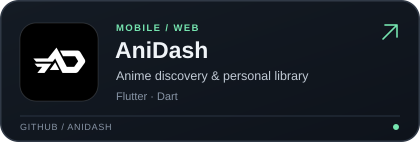
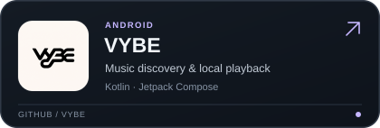
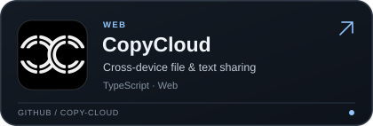
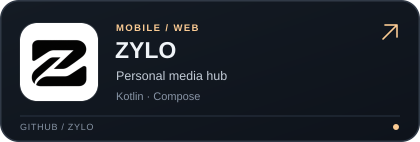

# Anshdeep Singh

**Building software at the intersection of engineering and design.**

Software development · Data science · Digital creation

[**Portfolio ↗**](https://anshdeepofficial1.vercel.app/) &nbsp; / &nbsp; [LinkedIn](https://www.linkedin.com/in/anshdeepofficial1/) &nbsp; / &nbsp; [Instagram](https://www.instagram.com/anshdeepofficial1/)

## 01 — Selected projects

&nbsp;

<a href="https://anidashweb.vercel.app/">AniDash website</a> · <a href="https://anidashgo.vercel.app/">Web app</a> &nbsp;&nbsp; | &nbsp;&nbsp; <a href="https://vybetune.vercel.app/">VYBE website</a>

&nbsp;

<a href="https://copycloud.me/">CopyCloud website</a> &nbsp;&nbsp; | &nbsp;&nbsp; <a href="https://zylod.vercel.app/home">ZYLO web app</a>

**Also building:** [Pitchcraft](https://github.com/anshdeepofficial1/Pitchcraft) · [DarkAnimeWalls](https://github.com/anshdeepofficial1/darkanimewalls) · [ZMB](https://github.com/anshdeepofficial1/ZMB) · [SocialBoost Android](https://github.com/anshdeepofficial1/SocialBoost-APP)

[All repositories ↗](https://github.com/anshdeepofficial1?tab=repositories)

## 02 — Contribution activity

## 03 — Repository intelligence

Metrics reflect the tracked public repositories, refreshed automatically by GitHub Actions.

## 04 — Recent development

[Explore repositories and releases ↗](https://github.com/anshdeepofficial1?tab=repositories)

## 05 — Engineering toolkit

**Mobile development**  
Flutter · Dart · Kotlin · Jetpack Compose · Android

**Web development**  
HTML · CSS · JavaScript · TypeScript · React · Next.js · PWA

**Systems & data**  
Rust · Tauri · Linux · Python · FastAPI · SQL · PostgreSQL

**Deployment & automation**  
GitHub · GitHub Actions · Vercel · CI/CD

## 06 — About

I'm a **BCA (Hons. with Research) Data Science student at Chandigarh University**, building mobile applications, full-stack web products and experimental systems. I focus on thoughtful interfaces, reliable software and practical automation.

---

[**Explore my portfolio ↗**](https://anshdeepofficial1.vercel.app/) &nbsp; / &nbsp; [Contact](https://anshdeepofficial1.vercel.app/contact)

